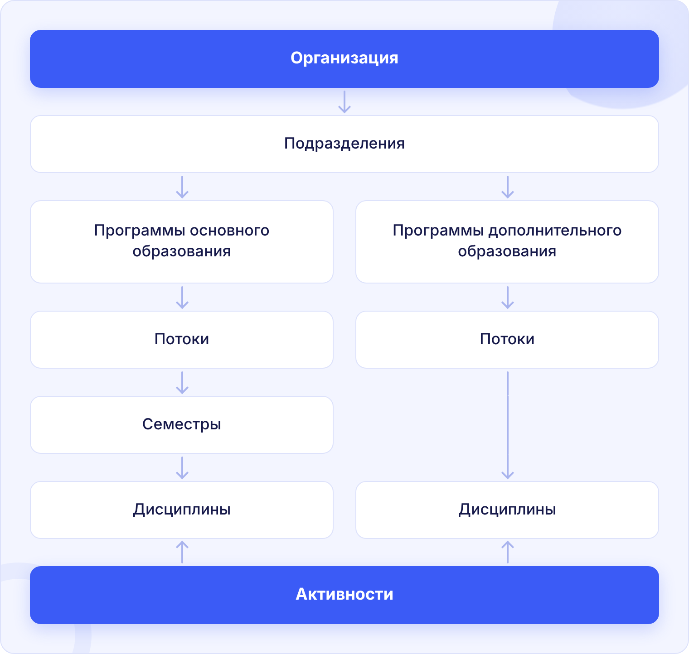

**LMS Odin** - система управления обучением. Облегчает создание и управление всеми образовательными процессами: создание и проведение онлайн-занятий, организацию асинхронных программ, оценку и аттестацию студентов.

:::tip

Про все обновления системы регулярно рассказываем в Telegram-канале [@odin_update](https://t.me/+JoF696WdDTxlNjhi) и в [справке](./novosti/podrobnee-obo-vsekh-obnovleniyakh/_index.md).

:::

{width=1520px height=1444px}

## Структура

- [Организация](./struktura/organizaciya/README.md)
- [Подразделение](./struktura/podrazdelenie.md)
- [Программа](./struktura/README/_index.md)
- [Поток](./struktura/potok.md)
- [Дисциплина](./struktura/disciplina/_index.md)

## Коммуникация

- [Уведомления](./kommunikaciya/uvedomleniya.md)
- [Чат](./kommunikaciya/chat/_index.md)
- [Видеозвонки](./kommunikaciya/videozvonki/_index.md)

[video:https://rutube.ru/video/310e4851ceeeb02bb51ae8a66fe53b47]

[html]

  

    Для образовательных организаций
    <h2 class="ob-title">Подключите свою организацию к&nbsp;Odin</h2>
    
Вузы, колледжи, школы и&nbsp;центры дополнительного образования ведут в&nbsp;Odin весь учебный процесс: от&nbsp;программ и&nbsp;потоков до&nbsp;оценок и&nbsp;выдачи результатов.

    <ul class="ob-list">
      <li>Онлайн-занятия и видеозвонки с записью</li>
      <li>Задания, контрольные и тесты</li>
      <li>Библиотека и биржа материалов</li>
      <li>Чаты, уведомления, посещаемость</li>
      <li>Аналитика и выгрузки по программам</li>
      <li>Интеграции: Moodle, SCORM, Google Календарь, API</li>
    </ul>
  

  

    
Получите демо-доступ

    
Оставьте заявку — мы свяжемся с вами, покажем систему и поможем с запуском.

    <a class="ob-btn" href="https://www.odin.study/connect/?utm_source=gramax&amp;utm_medium=banner&amp;utm_campaign=connect&amp;utm_content=odin" target="_blank" rel="noopener">Подключиться к Odin</a>
    <a class="ob-mail" href="mailto:sales@odin.study">или напишите на sales@odin.study</a>
  

[/html]
