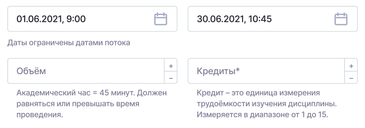
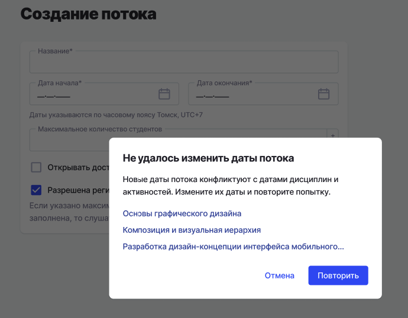

Могли возникать ситуации при которых слушатель может не иметь доступа к выполнению заданий/контрольных вследствие того, что сотрудники могли некорректно заполнять даты активностей (а именно из-за человеческого фактора даты находились за пределами дат потока). Чтобы подобных ситуаций не возникало, было решено добавить изменения, которые позволят пользователю на этапе создания/редактирования сущностей выбирать только доступные даты.

На страницах создания/редактирования дисциплин и активностей добавлены:

- Визуальное ограничение для выбора дат, которые находятся за пределами дат потока
- Пояснение под полем для выбора дат, что даты ограничены исключительно датами потока:

{width=751px height=264px}

Если даты и время для дисциплины/активности указываются вручную и при сохранении обнаруживается конфликт, то Дата начала/Дата окончания/Обе даты отметятся красной рамкой, и под ними показывается текст: "Обучение в рамках дисциплины/активности должно быть проведено в период с дата начала потока по дата окончания потока».

Если была попытка изменить даты потока и при попытке сохранения потока обнаруживаются конфликты с существующими датами проведения дисциплин/активностей, то отображается модальное окна с информацией, с какими из сущностей происходит конфликт:

{width=690px height=538px}

29\.10.2026
