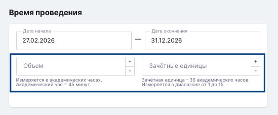

Указать количество академических часов в Odin возможно для:

- Образовательной программы
- Дисциплины
- Активности

Везде такое поле называется "Объем" с одинаковой подписью на "Измеряется в академических часах. Академический час = 45 минут".

Поле "Кредиты" у дисциплины переименовано в "Зачётные единицы". Только здесь подсказка будет немного отличаться: «Зачётная единица - 36 академических часов. Измеряется в диапазоне от 1 до 15».

{width=549px height=227px}

12\.11.2026
